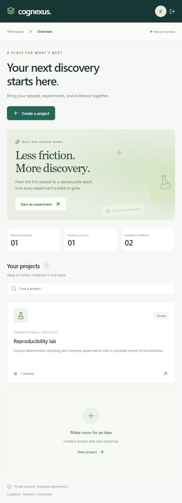
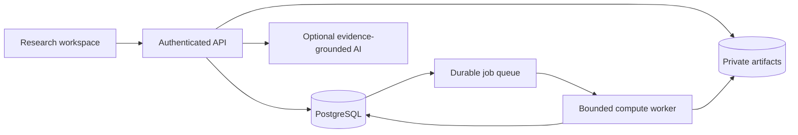

<div align="center">

# C O G N E X U S

### From research question to reproducible evidence.

A collaborative workspace for computational experiments, durable artifacts, and evidence-grounded analysis.

[](https://github.com/Prarth314/Cognexus-HPC/actions/workflows/ci.yml)
[](LICENSE)
[](https://www.typescriptlang.org/)

[Quick start](#start-exploring) · [Architecture](docs/ARCHITECTURE.md) · [Deployment](docs/DEPLOYMENT.md) · [Roadmap](docs/ROADMAP.md)

</div>

---

## The idea

Research should leave an inspectable trail. Cognexus connects a project's people, versioned inputs, execution parameters, result artifacts, and analysis so a run can be understood and repeated.



**Status: working research preview.** Real local CPU execution, durable projects, private files, and project permissions replace the original simulated prototype. This is a deployable foundation for a restricted pilot; institutional HPC integration, verified identity, independent security review, operational recovery drills, and domain validation remain release gates. No institutional deployment or performance scale is claimed.

## A workspace for the full experiment

| Workspace                                | Execution                          | Evidence                                 |
| ---------------------------------------- | ---------------------------------- | ---------------------------------------- |
| Private projects and explicit roles      | Validated workload templates       | Versioned inputs and checksums           |
| Durable uploads and authorized downloads | Persistent queues and cancellation | Immutable execution manifests            |
| Invitations and audit history            | Real bounded execution             | Run comparison and grounded explanations |

### Ask a question. Keep the evidence.

1. **Create a private project.** Invite collaborators or viewers with expiring, one-time codes.
2. **Bring a dataset.** Store immutable versions with SHA-256 integrity checks and previews from real content.
3. **Review before running.** Inspect parameters, input versions, runtime, and resource limits.
4. **Execute real work.** Durable jobs run approved workloads with cancellation, bounded recovery, and downloadable JSON artifacts.
5. **Compare and reproduce.** Clone parameters, inspect measured differences, and export an execution manifest.
6. **Ask the evidence.** Optionally request server-side Gemini explanations with a preserved evidence snapshot. No API key enters the browser.

## Start exploring

**Node.js 22.15+ · npm**

```sh
git clone https://github.com/Prarth314/Cognexus-HPC.git
cd Cognexus-HPC
npm ci
npm run dev
```

Open **http://localhost:3000**. Create a local account and project. No cloud account, Docker, cluster credentials, or AI key is required. Development data persists in ignored `.data/`.

For configuration, copy `.env.example` to `.env` (`Copy-Item .env.example .env` on PowerShell). Never expose development registration publicly. See the [deployment runbook](docs/DEPLOYMENT.md) for HTTPS, PostgreSQL, private storage, and restricted production registration.

## Real reference workflows

| Workflow           | Input                                    | Recorded outputs                                                      |
| ------------------ | ---------------------------------------- | --------------------------------------------------------------------- |
| Dataset statistics | CSV + numeric column, up to 100,000 rows | Count, missing values, mean, median, range, sample standard deviation |
| Seeded Monte Carlo | Seed + 1,000–2,000,000 samples           | Estimate of π, inside count, reference value, absolute error          |

Try [`examples/observations.csv`](examples/observations.csv) with column `value`: mean **2.5**, median **2.5**, **4** numeric observations and **1** missing value. These are bounded reference workflows; output-contract validation does not certify scientific validity.

## Under the surface



**React + TypeScript** · **Fastify** · **PostgreSQL / PGlite for development** · **Private disk / S3 adapter** · **Node worker threads**

Read the [architecture and tradeoffs](docs/ARCHITECTURE.md), [API reference](docs/API.md), and [capability checklist](docs/CAPABILITIES.md).

## Verification

```sh
npm run check
npm test
npm run build
npm run smoke
npm run format:check
npm audit --audit-level=moderate
```

Tests cover reference calculations, deterministic execution, authorization, invitations, sessions, integrity, idempotency, quotas, cancellation, and lease recovery. CI runs the API suite against embedded PostgreSQL and PostgreSQL 17, and verifies the container build. See each run's status rather than assuming an unexecuted CI workflow has passed.

The compiled HTTP smoke test starts the built server in an isolated temporary directory and exercises assets, registration, project creation, actual computation, and the artifact manifest. On restricted Windows sandboxes, persistent PGlite initialization may require running this check in a normal local shell.

## Deploy deliberately

The repository includes a non-root multi-stage Docker image and a single-server PostgreSQL Compose topology. Production startup requires an HTTPS public origin, PostgreSQL, and a strong operator-issued registration code. An external TLS proxy, backups, and monitoring must be provisioned by the operator.

**Current boundaries:** one application replica, 10 MiB uploads, 250 MiB / 500 artifacts per project, three active jobs per project, 100 jobs per project per 24 hours. No arbitrary code execution, Slurm submission, verified email, or monetary billing is implemented. [Offline account recovery and session management](docs/ACCOUNT_SECURITY.md) are available; email-based recovery and institutional identity remain planned. S3 and live AI require separately configured and tested accounts.

[Deployment & recovery guide →](docs/DEPLOYMENT.md)

**No cluster access yet?** Follow the [HPC pilot and access guide](docs/HPC_ACCESS.md) to prepare a sponsor-backed request and an administrator-approved integration. Local execution remains useful while access is being established.

## Work with us

Use feature branches and pull requests so collaborators can review changes safely. Follow [CONTRIBUTING.md](CONTRIBUTING.md), preserve provenance, and keep credentials and research data out of Git. Report sensitive issues through the process in [SECURITY.md](SECURITY.md).

## Origins

Originally built collaboratively for TAMUhack 2026 by Haren Thorat, Sunrut Mohanty, and Prarth Gupta. Original team repository: [Sunnerroots/Cognexus](https://github.com/Sunnerroots/Cognexus).

This independent continuation is maintained by Prarth Gupta with the original teammates' permission. Original Git history and authorship are preserved. New production work does not imply sole authorship of the original prototype.

## License

[MIT](LICENSE) · Copyright © 2026 Cognexus contributors.
