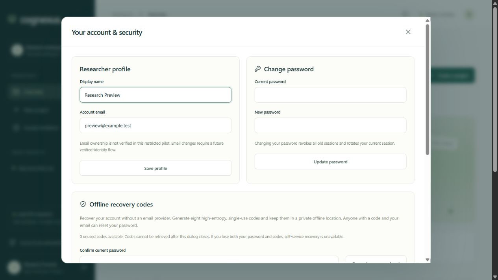

# Account security and recovery

Open **Account and security** in the workspace header to edit your display name, change your password, inspect/revoke sessions, create offline recovery codes, download account metadata, or inspect recent security activity.

## Offline recovery

1. Sign in and confirm your current password to generate eight random, single-use recovery codes.
2. Download them to a private offline location or a suitable password manager. The plaintext set is shown only in that response and is not retrievable from the server.
3. If you forget your password, choose **Recover with a saved code** on the sign-in screen. Enter your account email, one unused code, and a new password.
4. Successful recovery consumes that code and revokes every existing session. Sign in again with the new password. Other unused codes remain valid; regenerate the set if you suspect it was disclosed.

Generating a new set invalidates all previous codes. Store codes as carefully as a password: anyone possessing one and your email can reset your password. If both password and codes are lost, there is no self-service recovery. An operator must not reset an account based only on a claimed email address. Verified-identity support remains a launch requirement for broader onboarding.

The database stores only SHA-256 hashes of 128-bit random codes. Password reset and code consumption share a transaction and identity lock, so simultaneous use consumes a code at most once. Code regeneration and password changes require the current password and a still-valid session. Login, recovery, and password changes share the user identity lock to prevent old-password login racing a reset.

## Sessions and passwords

Passwords use salted scrypt. Session cookies are HttpOnly, SameSite=Lax, and Secure in production. Only opaque-token hashes are stored. Password changes revoke old sessions and issue a fresh current session. Recovery revokes all sessions without automatically signing in. Individual session revocation is restricted to its owning account.

Session listings expose creation/expiration times and whether the session is current; they do not expose authentication hashes or tokens. Session IDs are administrative identifiers, not bearer credentials. Sensitive endpoints are rate limited; production deployments also require suitable edge limits.

## Scope

Offline recovery is implemented. Email ownership verification, email-based recovery, institutional SSO, MFA, account deletion, and regulated-data suitability are not established. Account export contains profile, current project membership, and account-security events; it excludes authentication secrets and research file bytes. Research evidence is exported through authorized run manifests and downloads.
