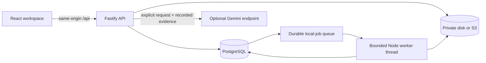

# Architecture

## Implemented boundaries

- Browser assets contain no provider keys. Cookie sessions are opaque; only SHA-256 hashes are stored. Passwords use salted Node scrypt. Mutations require a custom header and allowed origin; no cross-origin API access is enabled.
- Every project resource checks current database membership. Owners manage invitations and roles; collaborators upload/execute/analyze; viewers inspect. The final owner is protected with a project lock.
- Files are immutable random object keys. Downloads and previews verify SHA-256. File paths and shell commands are never taken from user input. Uploaded HTML is never rendered.
- PostgreSQL is required in production. PGlite provides a single-process, persisted development database. Migrations run transactionally under a PostgreSQL advisory lock.
- Job creation and idempotency checks are serialized per project. Workers claim jobs with `FOR UPDATE SKIP LOCKED`. Only approved, pure local workloads can retry after lease expiry, up to three attempts.
- Jobs execute outside the API event loop in a worker thread with a 30-second timeout and 128 MiB old-generation heap limit. This is not an OS security sandbox. Arbitrary code is not supported. Deployment memory/CPU limits bound the full process.
- Result completion is guarded by job status and attempt number. Artifacts are registered transactionally; cancellation cannot be overwritten by late completion. Input integrity is checked before execution.
- Successful execution, output validation, and domain validity are distinct. `validation_status=valid` means the reference output contract passed; it does not certify scientific claims.
- Analysis records retain question, answer, model, prompt version, and exact evidence snapshot. A model response is not automatically verified and must be reviewed.

## Deployment topology

Deploy one application replica initially. It serves frontend assets, API, and one local worker. PostgreSQL and object storage are external dependencies; local disk requires a persistent volume. Memory-only rate limits and global compute concurrency are not coordinated between application replicas. Do not scale replicas until those controls are externalized and tested.

## Deliberate limits

10 MiB/file; 250 MiB and 500 artifacts/project; three active runs/project; 100 runs/project/24 hours; two reference workloads; API list limits of 500 files, 200 runs, 100 audit events. Cursor pagination and configurable institutional quotas are future work. There is no Slurm submission, email delivery, verified identity, password recovery, cluster credential storage, or automatic monetary billing in this release.

## Important remaining failure windows

Storage and PostgreSQL cannot commit atomically. A hard process crash between object creation and metadata registration may leave an orphaned object. Cleanup is best effort during normal operation. Schedule inventory reconciliation before sustained production ingestion. Back up database and artifacts together; see the deployment runbook.

Local pure execution can be repeated after a worker crash; external compute must use a separate adapter with submission reconciliation. Do not reuse this retry strategy for Slurm or any expensive side-effectful operation.
