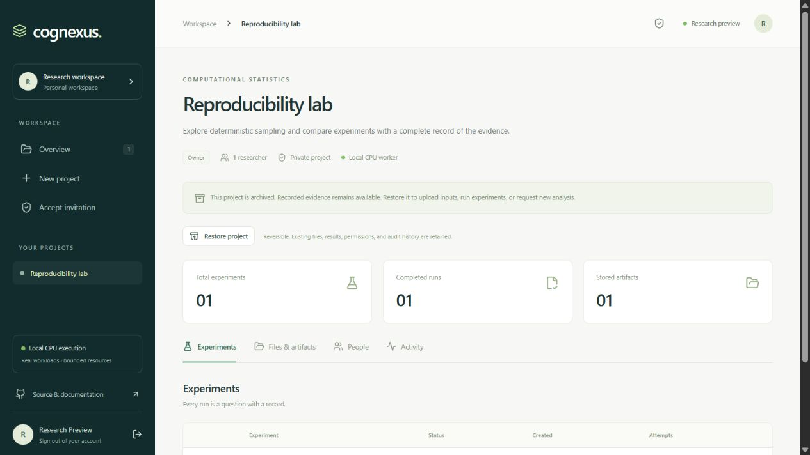

# Reversible project archiving

An owner can archive a project from its workspace. Active experiments must finish or be cancelled first. Archiving and submission share a project lock, so a concurrent submission cannot slip past the archived state.

Archived projects remain visible using **Archived projects** on the overview. Authorized members retain access to their files, recorded runs, manifests, previous analysis, and audit history. No file bytes or research records are deleted.

Archived projects reject uploads, new runs, project edits, new AI analysis, invitation creation, and invitation acceptance. Owners can still manage existing member access and revoke permissions. Restore the project to resume research. Both archive and restore actions are recorded in the project audit log.

Archiving does not free storage quota and does not implement legal retention or account deletion. Retention and permanent deletion require a separate explicit policy; they must preserve referenced-run provenance or record a controlled tombstone.
